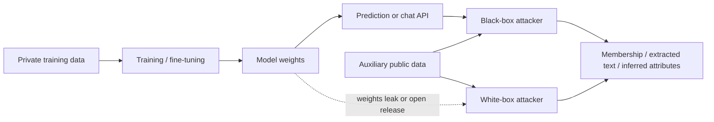

# The ML Privacy Problem and Threat Model

A trained model is a lossy summary of its training data. Usually the loss is the point: we want the model to learn general patterns and forget individuals. In practice models also keep traces of specific records, and anyone who can query the model, or read its weights, may be able to recover those traces. This book is about measuring that leakage and reducing it, from the defender's side.

The concern is not new. Chio and Freeman's *Machine Learning and Security* (O'Reilly, 2018) already warned that "some machine learning models generate outputs that allow an external observer to easily infer or reconstruct either the training data … or the test data", naming k-NN and kernel SVMs as easy cases because they store training points almost directly. Meta's *Llama 2 Responsible Use Guide* (2023) asks teams who fine-tune on personal data to "consider testing the outputs to see if the model memorized particular data" before release. What has changed since then is scale: large language models are trained on web crawls and private corpora, then exposed to millions of users through APIs.

## Four questions an attacker can ask

| Attack | Question the attacker answers | Typical access | Chapter |
|---|---|---|---|
| Membership inference | Was record *x* in the training set? | Scores or loss on chosen inputs | 2 |
| Training-data extraction | What verbatim strings did the model memorise? | Text generation API | 3 |
| Model inversion | What does a typical member of class *c* look like? | Confidence scores or gradients | 4 |
| Attribute inference | Given partial record *x*, what is its hidden field? | Predictions on crafted inputs | 4 |

Two follow-on questions matter for defenders. First, does a mitigation such as differential privacy (Chapter 5) actually bound these attacks? Second, after someone asks to be deleted, can we show their data no longer influences the model (Chapter 6)?

The 2020 IEEE survey by Sun, Liu, Wang, Cao and Kato, *When Machine Learning Meets Privacy in 6G*, gives a useful framing: membership inference is "a special case" of training data extraction, where the attacker cannot recover the full record but can still learn that it was used. Their healthcare example is the standard one. If a model was trained only on cancer patients, learning that a person is a member reveals the diagnosis.

## Threat model dimensions

Write the threat model down before testing. For every model you ship, fill in these rows.

| Dimension | Options | Why it matters |
|---|---|---|
| Access | label only, top-k scores, full logits, log-probs per token, weights | More output detail gives stronger attacks; weights allow white-box gradient attacks |
| Query budget | handful, rate-limited, unlimited | Shadow-model and extraction attacks need many queries |
| Auxiliary data | none, same-distribution sample, partial target record | Calibrated attacks need data from the same distribution |
| Target | any member, specific person, rare records, secrets (keys, IDs) | Average-case metrics hide worst-case leakage of rare records |
| Training pipeline | from scratch, fine-tune, RAG, continual updates | Fine-tuning on small private sets leaks more per record |
| Goal | audit, discovery in litigation, harassment, credential theft | Sets the harm, and so the tolerable risk |

Threat modelling books help here. Adam Shostack's *Threat Modeling: Designing for Security* (Wiley, 2014) has a chapter of privacy tools, including Solove's taxonomy of privacy harms and privacy impact assessments. Map each attack above to a Solove harm (for example "disclosure" or "aggregation") so that legal and product teams see the same risk you do.

## Why defenders should run the attacks

Attacks are the measuring instrument. You cannot claim "the model does not leak personal data" without a test that would have detected leakage. The same logic drives penetration testing: an untested control is an assumption. The attacks in this book are cheap enough to run in a CI job on small models and in a scheduled audit on large ones.

Two safety rules apply throughout:

- Only test models and data you own or are authorised to test. Running extraction against a third-party API can breach its terms and expose real people's data. If you find leakage in someone else's model, report it privately to the vendor and follow coordinated disclosure.
- Use synthetic records or planted canaries (fake secrets you insert yourself) whenever possible, so that a successful attack reveals nothing real.

## Worked example

*Execution status: not executed in this book's CI; verify locally. This is a procedure, not code output.*

Build a privacy risk register for one model. The example is a support-ticket classifier fine-tuned from an open base model on 40 000 internal tickets.

1. **Inventory data.** List the fields in the fine-tuning set: ticket text, customer email, account ID, product tier. Mark which are personal data.
2. **Inventory access.** The model is served behind an internal API that returns the top label and a confidence score. Employees in support (about 300 people) can call it without rate limits.
3. **Fill the threat table.** Access: top-1 score. Budget: unlimited. Auxiliary data: employees can see public tickets. Target: specific high-profile customers. Pipeline: fine-tune on a small set, so per-record leakage could be high.
4. **Choose tests.** Membership inference with a loss-threshold attack (Chapter 2) on 1 000 known members and 1 000 held-out tickets; canary insertion of 20 fake account IDs before the next retrain (Chapter 3).
5. **Choose metrics and thresholds.** Report attack true-positive rate at 0.1% and 1% false-positive rate, not accuracy. Set a release gate, for example "no canary with exposure above 10 bits".
6. **Record owners.** Name who runs the tests, who signs off, and how deletion requests reach the training pipeline.

Keep the register in version control next to the model card.

## Common pitfalls

- Treating "we only expose labels" as a privacy control. Label-only membership attacks exist; they need more queries, not more access.
- Reporting average attack accuracy. A model can look safe on average while leaking rare records badly.
- Forgetting fine-tuning and RAG corpora. The base model may be public, but the private fine-tuning set is what you are responsible for.
- Testing once at launch and never after retraining or after adding new data sources.
- Running attacks on real customer records when planted canaries would answer the same question.

## Exercises

1. Fill in the threat-model table for a model you operate. Which row has the most uncertainty?
2. Map each of the four attacks to one harm in Solove's taxonomy and write one sentence explaining the harm for your users.
3. Design five canary records (fake names, IDs or secrets) that you could plant in your next training run without confusing users or downstream systems.

## Further reading

- Shokri, Stronati, Song, Shmatikov, "Membership Inference Attacks Against Machine Learning Models", IEEE S&P 2017, arXiv:1610.05820
- Sun et al., "When Machine Learning Meets Privacy in 6G: A Survey", IEEE, 2020
- Meta, *Llama 2 Responsible Use Guide*, 2023 (section "Privacy adversarial attacks")
- Chio and Freeman, *Machine Learning and Security*, O'Reilly, 2018 (section "Data Privacy Safeguards and Guarantees")
- Shostack, *Threat Modeling: Designing for Security*, Wiley, 2014 (chapter 6, "Privacy Tools")
- NIST AI 100-2, *Adversarial Machine Learning: A Taxonomy and Terminology of Attacks and Mitigations*: <https://csrc.nist.gov/pubs/ai/100/2/e2025/final>
- Sibling books: **adversarial-ml-security-classifiers**, **ml-model-supply-chain-security**
